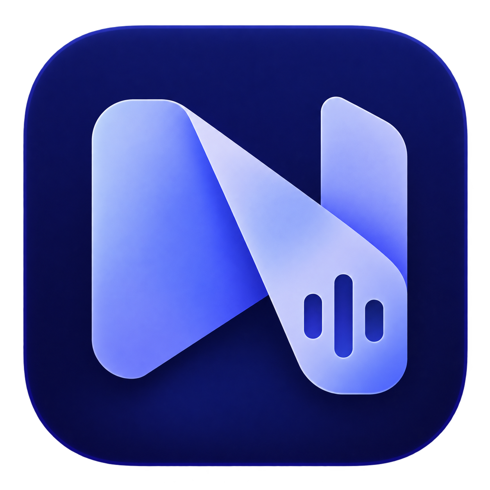

# Noter.ai



**A little space to think.**

Noter.ai is an AI-assisted notebook with editable Markdown notes, folders, meeting transcripts and searchable recordings. Organize a conversation into important details, decisions, dates and action items, review the draft, then save it to your notes.

[Desktop downloads](https://github.com/mrfost07/noter.ai/releases) · [Notebook guide](docs/NOTEBOOK_GUIDE.md) · [Desktop build guide](desktop/README.md) · [Release status and known issues](docs/RELEASE_STATUS.md)

## Features

- A tabbed notebook with Markdown editing, formatted preview, drafts and folders.
- A compact meeting companion with separate microphone and shared-audio transcription channels.
- Optional screen recording, local library storage, video playback and searchable timestamped transcripts.
- AI-organized meeting drafts with recording links, and readable answers to meeting questions.
- Persistent provider/model settings, including Groq Whisper transcription and supported AI connections.
- Managed Markdown copies and recordings stored on your device.

## Desktop downloads

Installers are attached to [GitHub Releases](https://github.com/mrfost07/noter.ai/releases) after successful candidate builds:

| Platform | Package |
| --- | --- |
| Windows x64 | Setup `.exe` and `.msi` |
| macOS Apple Silicon / Intel | Architecture-specific `.dmg` |
| Linux x64 | `.AppImage` and `.deb` — notes/review preview; live capture unavailable |

The first candidates are experimental. Read the [release status](docs/RELEASE_STATUS.md) for known functional issues, platform testing limits and signing status. Android APKs and automatic updates are not currently implemented.

[Code signing policy](CODE_SIGNING.md): Windows signing through SignPath Foundation is being prepared and requires eligibility approval. Current installers remain unsigned. [Privacy policy](PRIVACY.md).

After installing on Windows, use the Start menu shortcut or `Start-Noter.ai-Desktop.bat` in this checkout. `Start-Noter.ai-Browser.bat` opens the installed app's actual local server address in your browser; keep the desktop app open while using it. These launchers discover the installation and do not depend on the source folder's name. Browser access does not provide native desktop meeting controls.

## Build from source

The backend uses Go; the web app uses Node.js 24 and pnpm 11.0.1; desktop builds also require Rust and the platform's Tauri prerequisites.

```sh
pnpm --dir web install --frozen-lockfile
pnpm --dir desktop install --frozen-lockfile
```

Follow [desktop/README.md](desktop/README.md) to build your platform's installer. CI builds fresh frontend assets, embeds them into the Go sidecar and packages the native desktop app from the same committed revision.

Provider API keys are configured in the app and are not included in this repository or its release installers. Experimental desktop builds supply bundled reference installed-client OAuth configuration for account sign-in. Source builds can supply their own client. ChatGPT account sign-in and OpenAI API-key access are separate; see [AI connections](docs/AI_CONNECTIONS.md) and [release status](docs/RELEASE_STATUS.md). See [AGENTS.md](AGENTS.md) for repository commands and contribution conventions.

## Contribute

Noter.ai is an open-source project maintained by [mrfost07](https://github.com/mrfost07). Contributors and prospective maintainers are welcome: help improve notes, meeting capture, accessibility, AI integrations, documentation, and platform support.

Read the [contribution guide](CONTRIBUTING.md), browse [open issues](https://github.com/mrfost07/noter.ai/issues), or join [Discussions](https://github.com/mrfost07/noter.ai/discussions). To help maintain the project, start a discussion describing your experience and the area you would like to support.

## License

Noter.ai is available under the [MIT license](LICENSE).
